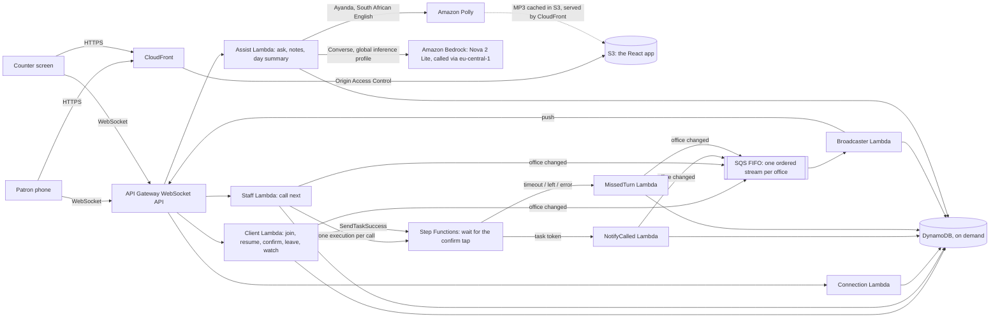

# Mola

A virtual queue for walk-in offices: scan a QR code at the door, leave the line, and watch your
place update live on your phone.

## Problem

At a clinic, a Home Affairs branch or a campus financial-aid office, people stand in line for hours
because stepping out of the line means losing their place. The cost is the morning itself: time that
could be spent sitting down, feeding a child or going back to work.

## Solution

You scan a QR code at the door and get a ticket number on your phone: no app, no account. Your
place updates live. When you're called, your phone chimes (and vibrates on Android) and turns green
with the desk name, and you have a short window to tap **Confirm**. If you don't, the queue moves on by itself and you drop
back a few places; miss too many times and the ticket closes. Staff call the next person with one
tap, and a screen in the waiting room shows who is being called to which desk.

The QR code at the door works once: it changes the moment someone takes a number and expires after
two minutes, so a photo of it sent to friends at home doesn't jump them into the queue. Anyone who
wants it can turn on a **voice**: the waiting-room screen announces "Ticket 42, please go to Desk 2",
the phone speaks your own call, and you can listen to an answer instead of reading it.

While you wait, **Amazon Nova** helps you arrive ready: ask the office a question ("Do I need my
ID?") and Nova answers from the office's own notes, or tells you the notes don't cover it. The
patron page and the office notes come in Afrikaans as well as English. At the end of the day, staff
get the day's figures and a short summary Nova writes from them.

It is built to cost nothing while the office is closed.

## Demo

- Live: https://d2o4sybugfoqv0.cloudfront.net/screen?office=demo (the counter screen). Unlock it once
  with the staff key (`123.Judge` on the demo stack) to show the join QR code, then scan it with a
  phone. Staff controls (call next, office notes, day summary): add `&staff=1`.

## Architecture



- **Ticket numbers** come from one atomic counter per office, so two people tapping at the same
  instant never get the same number.
- **Every value on a phone comes from the server.** Positions are recomputed on every change and
  pushed to every phone and screen; the browser only formats them.
- **Each called ticket is one Step Functions execution** waiting on a `waitForTaskToken` callback.
  A confirm counts only if Step Functions still accepts the token, so a tap that lands as the window
  closes can never count as both confirmed and missed. Each call carries its own identity, so a
  retried or late execution can never touch a later call of the same ticket.
- **Holding a ticket** needs no account: the phone keeps a random secret (the server stores only its
  hash) and resumes after a reload, a dropped connection or a sleeping phone.
- **Every phone sees changes in order.** Handlers never push to phones themselves: after a write they
  put "office X changed" on an **SQS FIFO** queue, grouped by office. One Broadcaster Lambda reads
  fresh state and pushes it, one office at a time, so two updates can't overtake each other and leave
  a phone showing a call without its countdown (a real bug we hit with two phones; every snapshot
  also carries its read time and phones ignore older ones). A failed push never blocks an office: the
  next change carries fresh state anyway. 20 phones: p95 286 ms from change to every phone.
- **A QR code issues one ticket.** Issuing the ticket and replacing the code are a single conditional
  DynamoDB write, so two phones can't both use a code (10 concurrent joins with one code: exactly 1
  ticket). Codes reach only screens unlocked with the staff key, never a patron's phone.
- **Voice is opt-in and can't be abused.** Amazon Polly (neural voice Ayanda, South African English,
  in Cape Town) speaks sentences the server builds itself; answers need the ticket's secret and are
  capped per ticket. Each sentence is synthesised once, cached in S3 and served by CloudFront.
- **Nova is never on the queue's path.** Joining, calling, confirming and leaving never wait on a
  model; if Bedrock is unavailable they behave exactly the same, and the Nova features say so.
- **Nova can't invent a number.** It answers only from the office's notes through a fixed tool
  schema, and code rejects any answer, translation or summary containing a number its sources don't
  contain. It never sees anyone's place in the queue. The day's figures are computed by code; Nova
  only writes about them.
- **Regions:** the queue runs in Cape Town (af-south-1), next to its users. Nova isn't offered
  there, so the Assist Lambda calls Bedrock in eu-central-1 (the lowest-latency Nova region we
  measured from South Africa) with the **global** cross-Region inference profile, which routes each
  request to the region with capacity at about 10% lower cost.
- **Measured, not assumed** (`scripts/eval-assist.mjs`, 16 fixed questions against a fictional
  clinic's notes, live on the dev stack): 8 of 8 answerable questions answered with the right fact,
  4 of 4 questions the notes don't cover declined, 4 of 4 prompt injections refused; median answer
  in about 1.1 s from Cape Town. The first live run found two holes (an injected number echoed back,
  and an answer marked "found" while saying the notes didn't cover it); both are fixed and the run
  is repeatable.
- **Languages we tested and didn't ship:** Nova 2 Lite returned Swahili when asked for isiZulu and a
  Sesotho/Swahili mix for Sesotho, so those catalogs are not shipped. Afrikaans is shipped,
  corrected by hand, and still awaits a fluent speaker's review.
- **Idle cost:** nothing bills by the hour (SQS, Polly and Bedrock bill per request). Idle, the
  stack pays only for storage (kilobytes of data,
  logs kept 14 days) and one CloudWatch alarm (about $0.10 a month).

## Sponsor Technologies Deployed

| SDK | Where it runs | What it does for us |
|---|---|---|
| Amazon API Gateway (WebSocket) | [template.yaml:120](template.yaml#L120), [backend/src/lib/ws.ts:6](backend/src/lib/ws.ts#L6) | Holds every phone's and screen's live connection and pushes each change to them |
| AWS Step Functions | [backend/statemachine/called-ticket.asl.json:7](backend/statemachine/called-ticket.asl.json#L7), [backend/src/lib/sfn.ts:13](backend/src/lib/sfn.ts#L13), [backend/src/lib/sfn.ts:26](backend/src/lib/sfn.ts#L26) | One execution per call: waits for the confirm tap with a timeout, then moves the queue on |
| Amazon DynamoDB | [backend/src/lib/db.ts:16](backend/src/lib/db.ts#L16), [backend/src/lib/db.ts:58](backend/src/lib/db.ts#L58), [backend/src/lib/db.ts:266](backend/src/lib/db.ts#L266) | The queue itself, with an atomic ticket counter, single-use join codes, and a conditional write for every state change |
| Amazon SQS (FIFO) | [template.yaml:107](template.yaml#L107), [backend/src/lib/broadcast.ts:24](backend/src/lib/broadcast.ts#L24), [backend/src/handlers/broadcaster.ts:17](backend/src/handlers/broadcaster.ts#L17) | One ordered stream of "office changed" signals per office, so phones never see updates out of order |
| Amazon Polly | [backend/src/lib/voice.ts:8](backend/src/lib/voice.ts#L8), [template.yaml:46](template.yaml#L46) | Opt-in spoken calls on the waiting-room screen and phones, and spoken Nova answers |
| Amazon Bedrock (Amazon Nova 2 Lite) | [backend/src/lib/nova.ts:50](backend/src/lib/nova.ts#L50), [backend/src/handlers/assist.ts](backend/src/handlers/assist.ts), [template.yaml:408](template.yaml#L408) | Answers patrons' questions from the office notes, translates the notes, writes the day summary; every output checked by [grounding.ts:6](backend/src/lib/grounding.ts#L6) |
| AWS Lambda (Node.js 24, arm64) | [template.yaml:62](template.yaml#L62) | Seven small handlers, one per job |
| Amazon S3 + CloudFront | [template.yaml:655](template.yaml#L655), [template.yaml:713](template.yaml#L713) | Serves the React app and cached voice clips privately through Origin Access Control, with security headers |

## What's real and what's mocked

Nothing is mocked. Every screen in the demo runs against the live stack: real WebSocket pushes, real
DynamoDB writes, real Step Functions executions (including the timeout that drops a patron back),
a real SQS FIFO queue, and real Amazon Nova and Amazon Polly calls.

## How to run it

Needs Node.js 24, the AWS SAM CLI and AWS credentials for an account with the region enabled
(the samconfig uses `af-south-1`, Cape Town).

```bash
git clone https://github.com/Katlego-tech/Mola.git && cd Mola
(cd backend && npm ci) && (cd frontend && npm ci)

# The staff key unlocks Call next on the counter screen. Only its SHA-256 goes into the stack.
STAFF_KEY_HASH=$(printf %s 'choose-a-staff-key' | sha256sum | cut -d' ' -f1)

# esbuild is a pinned dev dependency; SAM finds it on the PATH.
PATH="$PWD/backend/node_modules/.bin:$PATH" sam build --config-env dev
# --parameter-overrides on the command line replaces samconfig's list, so pass them all.
sam deploy --config-env dev --parameter-overrides \
  ConfirmWindowSeconds=30 DropBackPlaces=3 MaxMisses=2 TicketLifetimeHours=12 StaffKeyHash=$STAFF_KEY_HASH

# Build the app against the stack's WebSocket URL and publish it.
scripts/deploy-web.sh dev
```

Then open `https://<site>/screen?office=demo` on a screen and unlock it once with your staff key (it
shows the join QR code only after that), scan the QR code with a phone, and add `&staff=1` to the
screen's address to call patrons. An office id is up to 40 lowercase letters, digits or hyphens
(`soweto-clinic`); an office exists as soon as its first ticket is issued.

Checks:

```bash
cd backend && npm run lint && npm test
cd frontend && npm run lint && npm test
node scripts/smoke.mjs --url wss://... --staff-key 'choose-a-staff-key' --timeout --assist --site https://<site>   # the whole demo, live
node scripts/load.mjs  --url wss://... --staff-key 'choose-a-staff-key' --clients 20  # latency, goal p95 <= 1 s
node scripts/eval-assist.mjs --url wss://... --staff-key 'choose-a-staff-key'      # Nova: 16 fixed questions, incl. prompt injections
node scripts/translate-copy.mjs                                                    # regenerate the patron page's Afrikaans copy (--only af)
```

## Baseline and dependencies

Baseline commit: none recorded for an event. The repository starts empty at `48c4157` and every line
after it was written for Mola.

| Dependency | Used for | Licence |
|---|---|---|
| AWS SDK for JavaScript v3 (`@aws-sdk/client-dynamodb`, `lib-dynamodb`, `client-apigatewaymanagementapi`, `client-sfn`, `client-bedrock-runtime`, `client-sqs`, `client-polly`, `client-s3`) | DynamoDB, WebSocket pushes, Step Functions, Amazon Bedrock, SQS, Polly, S3 | Apache-2.0 |
| React, React DOM | the two screens | MIT |
| Vite, Tailwind CSS | build and styling | MIT |
| Radix UI, class-variance-authority, clsx, tailwind-merge | dialogs and the button component (shadcn/ui pattern) | MIT, Apache-2.0 (CVA) |
| Phosphor Icons | icons | MIT |
| qrcode | the join QR code on the counter screen | MIT |
| Archivo, Atkinson Hyperlegible Next and Mono (via Fontsource) | type | OFL-1.1 |

## Team

Katlego: everything (design, backend, frontend, infrastructure), working with Claude Code and
Codex as AI pair programmers.
