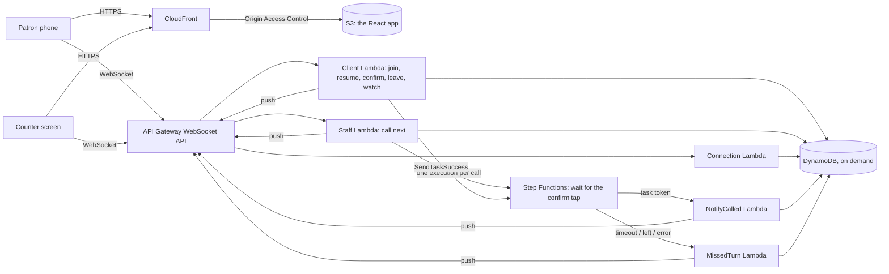

# Mola

A virtual queue for walk-in offices: scan a QR code at the door, leave the line, and watch your
place update live on your phone.

## Problem

At a clinic, a Home Affairs branch or a campus financial-aid office, people stand in line for hours
because stepping out of the line means losing their place. The cost is the morning itself: time that
could be spent sitting down, feeding a child or going back to work.

## Solution

You scan a QR code at the door and get a ticket number on your phone: no app, no account. Your
place updates live. When you're called, your phone buzzes and turns green with the desk name, and
you have a short window to tap **Confirm**. If you don't, the queue moves on by itself and you drop
back a few places; miss too many times and the ticket closes. Staff call the next person with one
tap, and a screen in the waiting room shows who is being called to which desk.

It is built to cost nothing while the office is closed.

## Demo

- Live: https://d2o4sybugfoqv0.cloudfront.net/screen?office=demo (the counter screen; its QR code
  opens the patron page). Staff controls: add `&staff=1`.
- Recorded walkthrough: the 3-minute video link goes here once it is recorded.

## Architecture



- **Ticket numbers** come from one atomic counter per office, so two people tapping at the same
  instant never get the same number.
- **Every value on a phone comes from the server.** Positions are recomputed on every change and
  pushed to every phone and screen; the browser only formats them.
- **Each called ticket is one Step Functions execution** waiting on a `waitForTaskToken` callback.
  A confirm counts only if Step Functions still accepts the token, so a tap that lands as the window
  closes can never count as both confirmed and missed. Each call carries its own identity, so a
  retried or late execution can never touch a later call of the same ticket.
- **Holding a ticket** needs no account: the phone keeps a random secret (the server stores only its
  hash) and resumes after a reload, a dropped connection or a sleeping phone.
- **Idle cost:** nothing bills by the hour. Idle, the stack pays only for storage (kilobytes of data,
  logs kept 14 days) and one CloudWatch alarm (about $0.10 a month).

## Sponsor Technologies Deployed

| SDK | Where it runs | What it does for us |
|---|---|---|
| Amazon API Gateway (WebSocket) | [template.yaml:83](template.yaml#L83), [backend/src/lib/ws.ts:12](backend/src/lib/ws.ts#L12) | Holds every phone's and screen's live connection and pushes each change to them |
| AWS Step Functions | [backend/statemachine/called-ticket.asl.json:8](backend/statemachine/called-ticket.asl.json#L8), [backend/src/lib/sfn.ts:14](backend/src/lib/sfn.ts#L14), [backend/src/lib/sfn.ts:28](backend/src/lib/sfn.ts#L28) | One execution per call: waits for the confirm tap with a timeout, then moves the queue on |
| Amazon DynamoDB | [backend/src/lib/db.ts:20](backend/src/lib/db.ts#L20), [backend/src/lib/db.ts:60](backend/src/lib/db.ts#L60) | The queue itself, with an atomic ticket counter and a conditional write for every state change |
| AWS Lambda (Node.js 24, arm64) | [template.yaml:43](template.yaml#L43) | Five small handlers, one per job |
| Amazon S3 + CloudFront | [template.yaml:465](template.yaml#L465) | Serves the React app privately through Origin Access Control, with security headers |

## What's real and what's mocked

Nothing is mocked. Every screen in the demo runs against the live stack: real WebSocket pushes, real
DynamoDB writes and real Step Functions executions, including the timeout that drops a patron back.

## How to run it

Needs Node.js 24, the AWS SAM CLI and AWS credentials for an account with the region enabled
(the samconfig uses `af-south-1`, Cape Town).

```bash
git clone https://github.com/Katlego-tech/Mola.git && cd Mola
(cd backend && npm ci) && (cd frontend && npm ci)

# The staff key unlocks Call next on the counter screen. Only its SHA-256 goes into the stack.
STAFF_KEY_HASH=$(printf %s 'choose-a-staff-key' | sha256sum | cut -d' ' -f1)

# esbuild is a pinned dev dependency; SAM finds it on the PATH.
PATH="$PWD/backend/node_modules/.bin:$PATH" sam build --config-env dev
# --parameter-overrides on the command line replaces samconfig's list, so pass them all.
sam deploy --config-env dev --parameter-overrides \
  ConfirmWindowSeconds=30 DropBackPlaces=3 MaxMisses=2 TicketLifetimeHours=12 StaffKeyHash=$STAFF_KEY_HASH

# Build the app against the stack's WebSocket URL and publish it.
scripts/deploy-web.sh dev
```

Then open `https://<site>/screen?office=demo` on a screen, scan its QR code with a phone, and add
`&staff=1` to the screen's address to call patrons. Any lowercase name works as an office id.

Checks:

```bash
cd backend && npm run lint && npm test
cd frontend && npm run lint && npm test
node scripts/smoke.mjs --url wss://... --staff-key 'choose-a-staff-key' --timeout   # the whole demo, live
node scripts/load.mjs  --url wss://... --staff-key 'choose-a-staff-key' --clients 20  # latency, goal p95 <= 1 s
```

## Baseline and dependencies

Baseline commit: none recorded for an event. The repository starts empty at `48c4157` and every line
after it was written for Mola.

| Dependency | Used for | Licence |
|---|---|---|
| AWS SDK for JavaScript v3 (`@aws-sdk/client-dynamodb`, `lib-dynamodb`, `client-apigatewaymanagementapi`, `client-sfn`) | DynamoDB, WebSocket pushes, Step Functions | Apache-2.0 |
| React, React DOM | the two screens | MIT |
| Vite, Tailwind CSS | build and styling | MIT |
| Radix UI, class-variance-authority, clsx, tailwind-merge | dialogs and the button component (shadcn/ui pattern) | MIT, Apache-2.0 (CVA) |
| Phosphor Icons | icons | MIT |
| qrcode | the join QR code on the counter screen | MIT |
| Archivo, Atkinson Hyperlegible Next and Mono (via Fontsource) | type | OFL-1.1 |

## Team

Katlego: everything (design, backend, frontend, infrastructure), working with Claude Code and
Codex as AI pair programmers.
