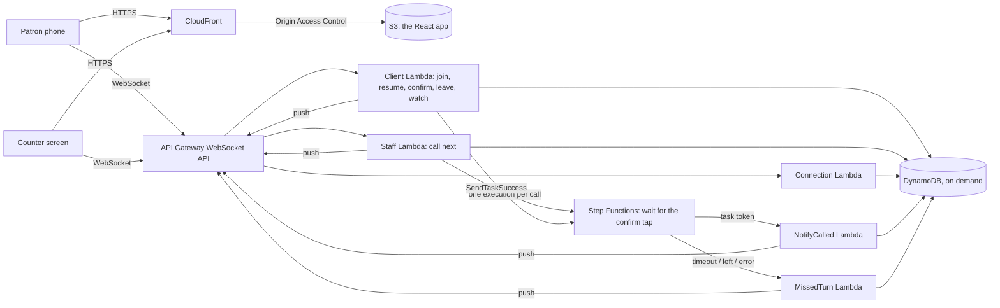

# Mola

A virtual queue for walk-in offices: clinics, Home Affairs branches, campus financial-aid offices.

People lose hours standing in line because leaving the line means losing their place. With Mola you
scan a QR code at the door, get a number on your phone (no app, no account), and watch your place
update live. When you're called you have a couple of minutes to tap **Confirm**. If you don't, the
queue moves on by itself and you drop back a few places; miss too many times and the ticket closes.

## How it works



- **Ticket numbers** come from one atomic counter per office in DynamoDB, so two people tapping at
  the same instant never get the same number.
- **Every value on a phone comes from the server.** Positions are computed from the queue on every
  change and pushed to every connected phone and screen; the browser only formats them.
- **Each called ticket is one Step Functions execution** that waits on a `waitForTaskToken`
  callback. The confirm tap succeeds only if Step Functions still accepts the token, so a tap that
  arrives as the window closes can never count as both "confirmed" and "missed". A timeout drops
  the patron back and calls the next person automatically.
- **Holding a ticket** needs no account: the phone keeps a random secret (the server stores only its
  hash) and resumes the ticket after a reload, a dropped connection or a sleeping phone.

## What it costs while the office is closed

Nothing that bills by the hour exists in the stack: API Gateway, Lambda, DynamoDB on demand, Step
Functions and CloudFront all bill per use. Idle, the stack pays only for storage (a few kilobytes of
data, logs kept 14 days) and one CloudWatch alarm (about $0.10 a month).

## Deploy it

Needs Node.js 24, the AWS SAM CLI and AWS credentials for an account with the target region
enabled (the samconfig uses `af-south-1`, Cape Town).

```bash
git clone https://github.com/Katlego-tech/Mola.git && cd Mola
(cd backend && npm ci) && (cd frontend && npm ci)

# The staff key unlocks Call next on the counter screen. Only its SHA-256 goes into the stack.
STAFF_KEY_HASH=$(printf %s 'choose-a-staff-key' | sha256sum | cut -d' ' -f1)

# esbuild is a pinned dev dependency; SAM finds it on the PATH.
PATH="$PWD/backend/node_modules/.bin:$PATH" sam build --config-env dev
# --parameter-overrides on the command line replaces samconfig's list, so pass them all.
sam deploy --config-env dev --parameter-overrides \
  ConfirmWindowSeconds=30 DropBackPlaces=3 MaxMisses=2 TicketLifetimeHours=12 StaffKeyHash=$STAFF_KEY_HASH

# Build the app against the stack's WebSocket URL and publish it.
scripts/deploy-web.sh dev
```

`deploy-web.sh` prints the site address. Then:

- **Counter screen (TV):** `https://<site>/screen?office=demo`. It shows the QR code patrons scan.
- **Staff controls:** `https://<site>/screen?office=demo&staff=1`, unlocked with the staff key.
- **Patron page:** what the QR code opens, `https://<site>/?office=demo`.

Any lowercase name works as an office id (`soweto-clinic`, `wits-financial-aid`); an office exists
as soon as its first ticket is issued.

## Check it

```bash
cd backend && npm run lint && npm test      # unit tests for every handler and rule
cd frontend && npm run lint && npm test     # view and app tests against a fake socket

# Against a deployed stack (WebSocket URL from the stack outputs):
node scripts/smoke.mjs --url wss://... --staff-key 'choose-a-staff-key' --timeout
node scripts/load.mjs  --url wss://... --staff-key 'choose-a-staff-key' --clients 100
```

The smoke test walks the whole demo: a screen watches, two patrons join and one resumes after
dropping its connection, the desk calls and one patron confirms, the next misses the window and
drops back, then leaves. The load test reports how long 100 phones take to hear about a call
(goal: p95 under one second).

## Status

Built and unit-tested end to end: taking a ticket, live positions, calling, confirming, missing a
turn, leaving, the counter screen and staff controls. The deployed checks above are being run
against the dev stack.
